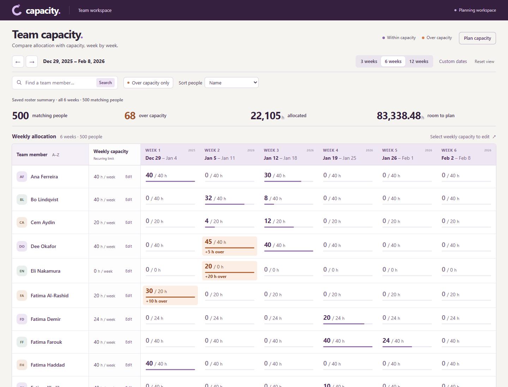
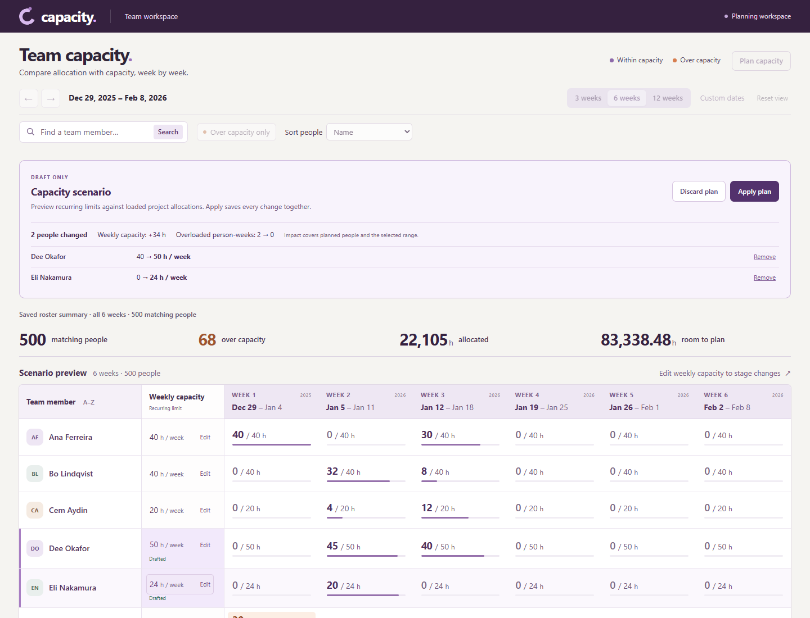
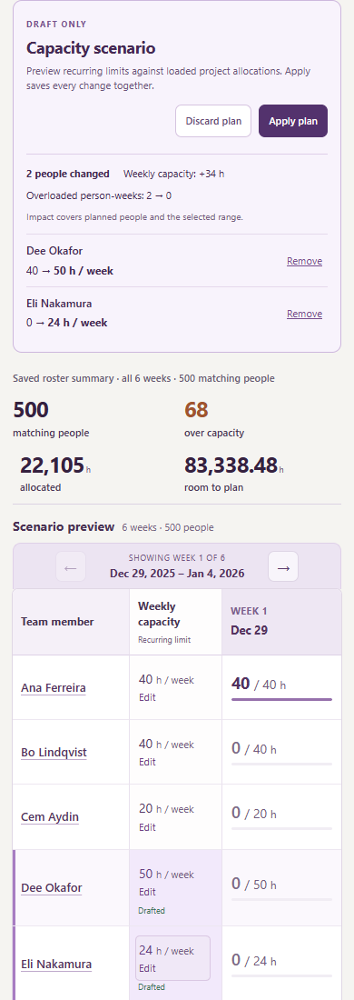

# Team capacity

A weekly capacity grid for spotting overload and changing recurring capacity without
losing track of saved values. The Go/PostgreSQL API and React/TypeScript UI run in the
supplied Docker Compose environment.

## Core workflow

- Navigate weeks, use a 3-, 6-, or 12-week preset, or apply a custom date range.
- Compare allocated hours with capacity, including people with zero allocation or
  zero capacity. Search the roster, filter overload, and prioritize its highest peaks.
- Edit weekly capacity inline. Confirmed saves update every displayed week; failed
  saves keep the draft, and conflicting edits require an explicit choice.
- Inspect a person's project breakdown to understand an overloaded week.

The optional **Plan capacity** workflow previews recurring-limit changes across people
before saving. One atomic apply keeps a plan from being partly saved when someone
else changes a starting value. This changes capacity limits; it does not rebalance
project assignments. Plans are local to the open browser view.

## Screenshots

The six-week grid shows saved allocation and capacity, with overloads emphasized.



<details>
<summary>Scenario preview and mobile layout</summary>

Staged recurring-capacity changes remain a preview until the plan is applied.



The mobile view keeps one selected week readable alongside each person's capacity.



</details>

## Run

Requires Docker with Docker Compose v2, Make, and free ports 3000 and 8080.

```bash
make up
```

Open [the capacity grid](http://localhost:3000). The API is on
[localhost:8080](http://localhost:8080/api/health). Keep `make up` running; frontend
changes reload automatically. Restart it after backend changes to rebuild the API.

```bash
make down   # stop and remove the containers
```

The Compose files, Dockerfiles, Makefile, schema, and seed are unchanged. Vite is
patched to 8.2.4. Local loopback-only port bindings can be supplied in a separate
uncommitted Compose override. This local scaffold has no authentication.

## Two-minute tour

1. Search for **Dee**. In the week of January 5, 2026, their allocation is **45/40 h**.
   Select Dee's name: Atlas contributes 30 h and Corvus 15 h. Clear search to inspect
   Eli's **20/0 h**, which also counts as overload without an infinite percentage.
2. Edit Dee's weekly limit, save, and check all displayed weeks. Reload to confirm
   persistence. To check conflicts, open the same person's editor in two tabs before
   saving either. Save in the first, then submit a different value in the second.
3. Choose **Plan capacity**, stage limits for two people, and inspect the preview.
   Saved values remain unchanged until **Apply plan** succeeds; reload another tab
   to check persistence. Discarding a draft reloads current saved values.

## Verify

With the containers running:

```bash
docker compose exec -T api go test -v ./...
docker compose exec -T api go vet ./...
docker compose exec -T web npm test
docker compose exec -T web npm run build
```

The current suites contain **17 Go tests and 26 frontend tests**. PostgreSQL fixtures
run inside rolled-back transactions. Browser checks cover persistence, failures,
conflicts, lost responses, keyboard recovery, mobile navigation, and scenarios.

Independent arithmetic matched 75,585 seed cells and 31,314 cells in an isolated
3,000-person / 757,170-assignment fixture. Sample 105-week requests took 1.28–1.30 s
locally; these sequential repeated-seed observations do not measure production
concurrency. Roster pages and date bounds keep the browser workload bounded.

[Architecture](docs/ARCHITECTURE.md) maps the components, data flow, and save/recovery
boundaries. [Decisions](DECISIONS.md) explain the tradeoffs. The
[API and behavior reference](docs/API.md) contains contracts and detailed checks.
The unmodified [original assignment](ASSIGNMENT.md) and [worklog](.notes/worklog.md)
preserve the brief and implementation checkpoints.
